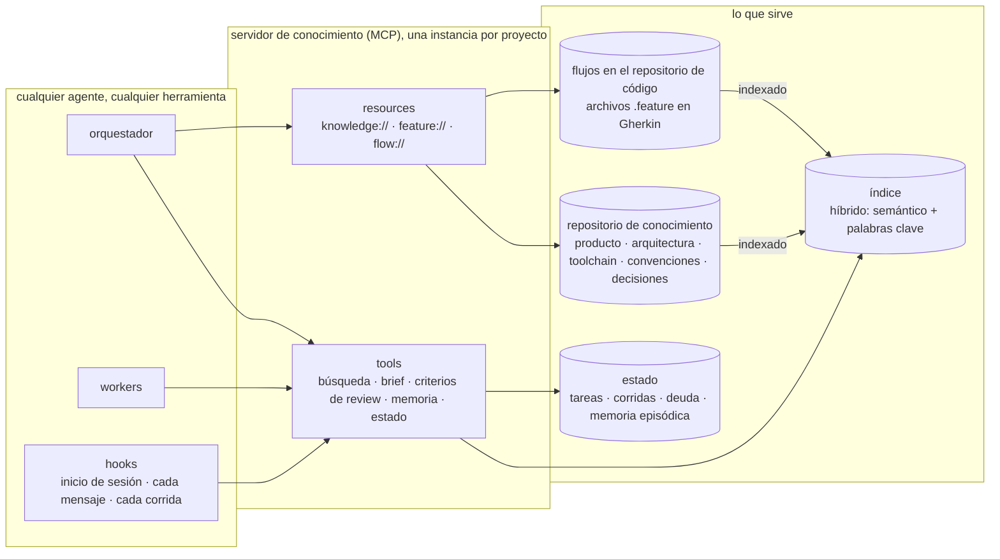
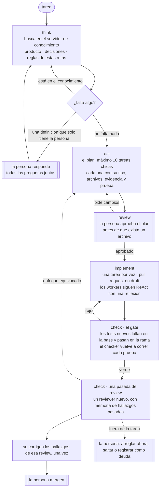

# TypedSpec

**El TypeScript del desarrollo guiado por specs (SDD).** TypeScript no reemplazó a JavaScript: le agregó tipos que una máquina verifica antes de ejecutar. TypedSpec no reemplaza a SDD: conserva lo que SDD ya hace y lo vuelve verificable.

> **Sin receipts no hay merge.**

[Read in English](README.md)

---

## Por qué existe

Pasé meses construyendo un harness para desarrollar un producto real con agentes de IA: hooks, gates, skills y validaciones. En un momento el proyecto tenía más de una línea de harness por cada línea de producto, y casi todo servía solo para ese producto.

De ahí salieron dos lecciones:

1. **El harness no es lo importante. Lo importante es el contexto.** Lo que cambió la calidad del trabajo fue *qué ve el agente, en qué momento y con qué garantías*. Eso es context engineering, y TypedSpec es un método para hacerlo a propósito.
2. **Casi todo lo que construí a mano ya existía.** Especificaciones ejecutables, documentación viva, registros de decisiones, rojo antes que verde: generaciones de gente ya lo pensaron. Un método para agentes de IA tiene que apoyarse en eso, no reinventarlo.

## En qué se apoya

TypedSpec inventa poco. Pone prácticas probadas delante de los agentes de IA y suma las dos piezas que les faltan:

| Práctica | Qué toma TypedSpec |
|---|---|
| [Behaviour-Driven Development](https://dannorth.net/introducing-bdd/) (Dan North) y [Gherkin](https://cucumber.io/docs/gherkin/) | Flujos escritos en el lenguaje del negocio, ejecutables |
| Specification by Example (Gojko Adzic) | La spec, el test y la documentación son un solo artefacto |
| Living Documentation (Cyrille Martraire) | Documentación que no puede quedar vieja, porque falla si miente |
| TDD y ATDD | El test de aceptación primero; tiene que fallar antes de que exista el cambio |
| [Architecture Decision Records](https://cognitect.com/blog/2011/11/15/documenting-architecture-decisions) (Michael Nygard) | Una decisión corta por archivo, que nunca se borra, solo se reemplaza |
| Lenguaje ubicuo (DDD, Eric Evans) | Las mismas palabras en los flujos, el código y la interfaz |

Lo nuevo es el **servidor de conocimiento**, que le da a cada agente exactamente el contexto que necesita, y el **checker**, que vuelve a correr cada prueba en lugar de creerle al agente.

## La premisa

**Un harness se puede construir a medida que se escribe el código, y evoluciona con quienes lo usan.** Cada tarea lo pone a prueba contra el conocimiento del proyecto y, si falta algo, lo completa:

- **Si falta una definición**, el orquestador guía a la persona: *"para seguir te falta definir A y B"*. Pregunta todo junto y solo lo que bloquea.
- **Si falta una regla**, propone un cambio del harness (un test, un eval, un flujo de punta a punta, un hook) y la persona aprueba el diff.
- **Reglas, no prosa**: una regla que el modelo puede ignorar es un deseo. Cada regla es un check ejecutable.
- **Dinámico en las dos direcciones**: cada regla registra cuándo dispara; la que nunca dispara se propone para retiro.

## Igual para todos los proyectos

TypedSpec es una fábrica, no el harness de un producto. El método es el mismo para un restaurante, un banco, una institución pública, un bufete, un retail o un videojuego, en cualquier stack. Cada proyecto solo declara sus propios valores, en su propio conocimiento.

| Siempre igual | Lo declara cada proyecto |
|---|---|
| El grafo: think → act → review → implement → check | Qué revisa cada nodo en ese dominio |
| Tipos de tarea (feature, bug, chore, harness, question) y sus campos | Las capas y los archivos de cada una |
| Paradas humanas: el plan y el merge | Las áreas de riesgo que suman una parada |
| Los gates existen; el test nuevo falla antes del cambio y pasa después; un checker vuelve a correr las pruebas | Los comandos (`pnpm verify`, `pytest`, `go test`) |
| TDD siempre; de punta a punta cuando hay un flujo que ve el usuario | La evidencia por capa (story de un componente, colección de API, test de replay) |
| Flujos en Gherkin, leídos con el parser oficial, en el idioma del proyecto | El runner del stack (playwright-bdd, behave, godog) |
| Un solo layout de conocimiento, así cada proyecto sirve los mismos resources | Su contenido: producto, arquitectura, toolchain, regulación |
| Agentes por rol: implementer, reviewer, build fixer, debugger, explorer | Los criterios de review, que llegan como contexto |
| Skills por actividad: planificar, revisar, estado, guardar un punto | Los datos que leen |

Antes de sumar cualquier pieza, dos preguntas: *¿funcionaría igual en otro stack (una API en Python, un servicio en Go)?* y *¿funcionaría igual en otro dominio (un banco, un bufete, un videojuego)?* Si no, la parte que cambia es del conocimiento del proyecto, no del método.

## La base: un servidor de conocimiento

Todo lee y escribe en un mismo lugar: un **servidor de conocimiento**, construido como servidor [MCP](https://modelcontextprotocol.io). El harness puede cambiar de forma; el servidor de conocimiento es lo que hace que todos los agentes, en todas las herramientas, trabajen con el mismo contexto. Una instancia sirve a un proyecto, con su propio almacén.



- **Tres almacenes, nunca mezclados.** El *conocimiento* es texto curado en un repositorio, versionado y revisado. La *memoria episódica* (lo que aprendió una corrida) tiene fecha y expira salvo que se promueva a decisión. El *estado operativo* (tareas, corridas, deuda) son filas tipadas, consultadas por filtros, nunca embebidas.
- **Dos mitades de la búsqueda.** Un índice híbrido responde *qué se parece*, entre idiomas; el almacén relacional responde *qué es exacto*: qué decisión gobierna este módulo, qué regla aplica a esta ruta.
- **El contexto llega sin pedirlo.** Antes de que el modelo lea el mensaje de una persona, un hook le pide al servidor lo relevante y lo inyecta. Un saludo no recibe nada, así que no cuesta nada.
- **Criterios de review por ruta.** El reviewer recibe las reglas de los archivos del diff y el texto exacto de los flujos que toca la tarea.
- **Flujos como diagramas, generados.** `flow://<capacidad>` dibuja los escenarios Gherkin como diagrama cuando se pide, así el dibujo nunca contradice la spec.
- **Memoria que sobrevive a la sesión.** Una sesión nueva arranca desde el último resumen y lo pendiente, sin importar qué agente la abra.
- **Telemetría en el mismo lugar.** Cada corrida registra su worker, nodo, modelo, tokens, duración y veredicto.

## El grafo

Cada cambio recorre el mismo grafo. Dos pasos son de una persona: aprobar el plan y mergear.



- **think** sigue buscando en el conocimiento antes de preguntar; a la persona le pregunta solo lo que el conocimiento no responde, y todo junto.
- **act** escribe el plan. Una tarea que no entra se divide; una tarea sin prueba ejecutable no es una tarea.
- **review** es la primera parada humana, antes de que exista código, cuando cambiar de rumbo es más barato.
- **implement** corre workers que siguen ReAct con una línea de reflexión. La confianza que declaran se registra como métrica, nunca como evidencia. La cuarta falla escala con las hipótesis probadas.
- **check** tiene dos partes. El gate prueba el cambio mecánicamente: cada test nuevo tiene que fallar en la base y pasar en la rama, y el checker vuelve a correr las pruebas él mismo. Después, una pasada de review; sus hallazgos se corrigen una vez y la persona mergea. Sin lazos de review.

## Evidencia por tipo de tarea

El método le exige una sola cosa a cada tarea: una prueba ejecutable que falle sin el cambio. Qué prueba, lo elige el proyecto, por tipo y por capa.

| Tipo | Lo que exige el método | Lo que eligió un proyecto (un SaaS web) |
|---|---|---|
| feature | el escenario del flujo falla primero y después pasa | componente: story + test unitario · API: contract test, colección de API con asserts, endpoint documentado · flujo: Gherkin de punta a punta |
| bug | la reproducción falla en la base y pasa en la rama | la misma reproducción, como test |
| chore | los tests existentes siguen verdes, sin tocarlos | — |
| harness | un test del script o del hook, o un eval | eval cuando cambia un agente o un prompt |
| question | una respuesta dentro de su límite; sin código | — |

Un videojuego elegiría tests de replay y de simulación; un banco sumaría un check de trazabilidad por cada movimiento de dinero. La regla es la misma: verificar valores del negocio, nunca estructura — *el total es 12980*, no *el total es mayor que cero*, y nunca nombres de clases ni markup.

## Specs que se ejecutan

Un flujo se escribe una sola vez, en Gherkin, en el lenguaje del negocio, y es a la vez la especificación, el test y la documentación:

```gherkin
# language: es
Característica: Historial de pedidos
  Escenario: Un comensal ve solo sus pedidos
    Dado un restaurante "demo" con un producto "Pizza" a 9990 y envío a 2990
    Cuando un invitado pide 1 "Pizza" como "ana@test.com"
    Y "ana@test.com" abre su historial de pedidos
    Entonces ve 1 pedido con total 12980
    Y no ve pedidos de "luis@test.com"
```

- **Los flujos sobreviven a la tecnología.** Los steps encuentran las cosas como un usuario: por rol y texto visible, nunca por nombres de clases. Se puede borrar el código, reconstruirlo en otro framework, y los flujos dicen cuándo está terminado.
- **Los flujos viven junto al código** que los hace pasar, así un flujo y sus steps cambian en un solo pull request. El servidor de conocimiento los indexa y los sirve.
- **Se escriben en términos del negocio.** "Cuando un invitado pide 2 pizzas", no "click, escribo, click". Los escenarios imperativos son la forma clásica en que BDD se pudre.

Más en [`examples/`](examples/).

## El layout del conocimiento

El conocimiento de cada proyecto tiene la misma forma, así el servidor ofrece los mismos resources en todos:

```
knowledge/<proyecto>/
  index.md        el mapa: una línea por documento vigente
  prd/            qué se construye y por qué: producto, usuarios, requisitos, roadmap
  asd/            arquitectura: stack, límites, patrones, datos
  dtr/            toolchain: versiones, build, tests, CI, scripts
  conventions/    cómo se trabaja: código, review, proceso
  decisions/      ADRs, una sola numeración
  howto/          guías de tareas, una por archivo
  history/        registros congelados: cambios, auditorías, investigación, planes, snapshots
  assets/         imágenes, PDFs, grabaciones: nunca se indexan, se enlazan desde el texto que los explica
```

Cada documento lleva frontmatter (`id`, `type`, `status`, `summary`, `links`, `supersedes`), así los documentos forman un grafo que el servidor puede recorrer, y la búsqueda devuelve solo lo vigente salvo que se pida historia. La investigación nunca edita directamente el producto ni los flujos: lo que vale la pena se convierte en una decisión o un escenario mediante un diff que aprueba la persona.

## Principios de context engineering

1. **Buscar antes de preguntar.** Los agentes reciben las reglas de los archivos que van a tocar, no documentos enteros. Es también la respuesta al *lost in the middle*.
2. **Reglas como código, no prosa.** La prosa de instrucciones no puede crecer: un check cuenta sus palabras.
3. **La confianza es una métrica, no evidencia.** "Listo, funciona" no prueba nada; un proceso aparte vuelve a correr la prueba.
4. **Plan antes que código.** Corregir un plan es mucho más barato que corregir código.
5. **Medir antes de decidir.** Un ejemplo: resumir automáticamente un contexto que la búsqueda ya había filtrado perdía hasta la mitad de los datos que importaban.
6. **Usar la práctica que ya existe.** Antes de escribir un script nuevo, nombrar la práctica establecida que lo resuelve y usar su herramienta estándar.
7. **El harness crece y se poda.** Las reglas que nunca disparan se van.

## Estado

Los principios vienen de meses de práctica diaria en un producto real. El método se está piloteando ahora, un pull request corto por vez, empezando por pasar los smoke scripts escritos a mano de ese producto a flujos Gherkin. Este repositorio va a juntar lo que mida el piloto, incluido lo que no funcione.

## Licencia

[CC BY 4.0](LICENSE): se puede compartir y adaptar citando la fuente.
