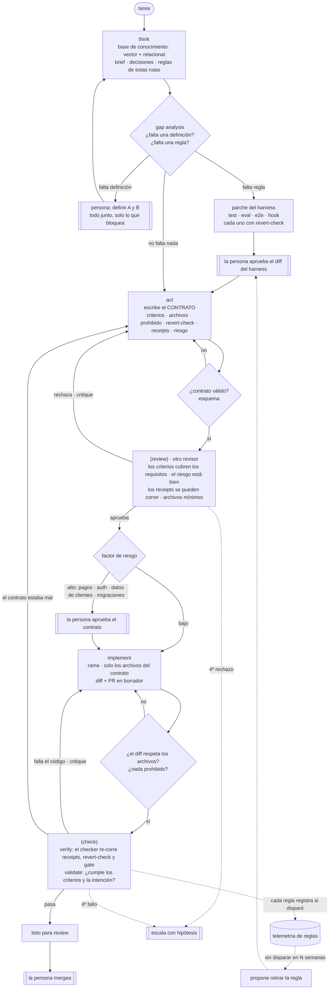

# TypedSpec

**El TypeScript del desarrollo guiado por specs (SDD).** TypeScript no reemplazó a JavaScript: le agregó tipos que una máquina verifica antes de ejecutar. TypedSpec no reemplaza a SDD: conserva lo que SDD ya hace y lo vuelve verificable.

> **Sin receipts no hay merge.**

[Read in English](README.md)

---

## Por qué existe

Pasé meses construyendo un harness para desarrollar un producto real con agentes de IA: hooks, gates, skills y validaciones. En un momento el proyecto tenía más de una línea de harness por cada línea de producto.

La lección no fue la que esperaba: **el harness no es lo importante. Lo importante es el contexto.** Lo que cambió la calidad del trabajo fue *qué ve el agente, en qué momento y con qué garantías*. Eso es context engineering, y TypedSpec es un método para hacerlo a propósito.

## La premisa

**Un harness se puede construir a medida que se escribe el código, y evoluciona con quienes lo usan.** No se escribe entero al principio. Cada tarea lo pone a prueba contra el conocimiento del proyecto (brief, decisiones de arquitectura, decisiones previas) y, si falta algo, lo completa:

- **Si falta una definición**, el orquestador guía a la persona: *"para seguir te falta definir A y B"*. Pregunta todo junto y solo lo que bloquea.
- **Si falta una regla**, propone un parche del harness (un test, un eval, un E2E o un hook) y la persona aprueba el diff.
- **Reglas, no prosa**: cada regla nueva es un check ejecutable que nace con su revert-check, la prueba de que puede fallar. Una regla que nunca falla es prosa disfrazada de código.
- **Dinámico en las dos direcciones**: cada regla registra cuándo dispara. La que nunca dispara se propone para retiro, y el harness no engorda.

## Lo que SDD ya da y lo que TypedSpec agrega

Birgitta Böckeler (Thoughtworks) describe tres niveles de SDD: *spec-first*, *spec-anchored* y *spec-as-source*. TypedSpec se ubica en **spec-as-source** y conserva el núcleo de SDD:

| SDD ya hace | TypedSpec lo conserva y agrega |
|---|---|
| Requisitos y escenarios (GIVEN / WHEN / THEN) | Escenarios como **registros estructurados** (YAML) con ID estable, enlazados a los tests que los hacen cumplir |
| Un plan aprobado antes de implementar | Un **contrato tipado** por pull request, validado por un esquema y revisado *antes* de escribir código |
| Tareas con criterios de aceptación | Criterios de aceptación, archivos permitidos, lo prohibido, un revert-check y un **factor de riesgo** |
| Review y CI | **Receipts**: los comandos de prueba los vuelve a correr otro proceso; nunca se toma la palabra del agente |

| TypeScript | TypedSpec |
|---|---|
| tipos | el contrato: criterios, archivos, prohibido, receipts, riesgo |
| `tsc` antes de correr | el esquema y el review del contrato antes de implementar |
| tests en runtime | el check: receipts re-corridos por el checker |
| `strict` | riesgo alto: una persona aprueba el contrato |

## El grafo

Cada pull request recorre el mismo grafo dirigido. **Los nodos entre paréntesis se repiten hasta pasar**, con tope: al cuarto fallo se escala a una persona con las hipótesis probadas.



En el vocabulario de patrones de agentes es un **workflow** (las rutas las fija el código, no el modelo). Por dentro es prompt chaining con gates programáticos y combina:
- dos lazos **evaluator-optimizer**: el review del contrato y el check de la implementación;
- **routing** por riesgo;
- un **interrupt** humano, solo cuando el riesgo es alto;
- **orchestrator-workers**: un orquestador y workers más baratos.

Cada worker sigue ReAct con una línea de reflexión, y la confianza que declara es una métrica, nunca una evidencia.

## Principios de context engineering

1. **Buscar antes de preguntar.** El agente no recibe documentos enteros. Recibe las reglas que aplican a los archivos que va a tocar, sacadas de una base de conocimiento con dos mitades: la vectorial busca *lo parecido* y la relacional responde *lo exacto* (qué decisión rige este módulo, qué regla aplica a esta ruta y qué check la hace cumplir). Esa es también la respuesta al *lost in the middle*.
2. **Reglas como código, no como prosa.** Una regla que el modelo puede ignorar es un deseo. Cada regla es un test, un hook o un eval, y la prosa de instrucciones tiene prohibido crecer: hay un check que cuenta sus palabras.
3. **La confianza es una métrica, no una evidencia.** "Listo, funciona" no prueba nada. Otro proceso vuelve a correr la prueba, y así se detecta la evidencia fabricada.
4. **Contrato antes que código.** Corregir un contrato es mucho más barato que corregir código.
5. **El riesgo decide cuándo interviene la persona.** Un cambio de riesgo alto se detiene en el contrato; uno de riesgo bajo, solo en el merge.
6. **Medir antes de decidir.** Las ideas que suenan bien se miden antes. Un ejemplo de la práctica: resumir automáticamente un contexto que la búsqueda ya había filtrado perdía hasta la mitad de los datos que importaban.
7. **El harness crece y también se poda.** La regla que nunca dispara se va.

## Spec as source

Un escenario es un registro, no un párrafo. El YAML del repositorio es la fuente de verdad, porque se revisa en los pull requests y tiene historia en git. Una base de datos lo indexa para que los agentes lo consulten rápido y barato.

```yaml
- id: no-session-is-refused
  capability: orders
  given: un pedido sin sesión
  when: POST /orders
  then: responde 401
  applies_to: [apps/api/src/modules/orders/]
  decisions: [ADR-012]
  enforced_by: [orders.e2e-spec.ts#no-session-is-refused]
```

- **El drift pasa a ser un check rojo.** Un escenario cuyo `enforced_by` no existe, o un test que cita un ID desconocido, hace fallar el gate.
- **El contexto es exacto.** Cada agente recibe solo los escenarios cuyo `applies_to` coincide con los archivos de su contrato.

Más ejemplos: [`examples/scenario.yaml`](examples/scenario.yaml), [`examples/contract.yaml`](examples/contract.yaml).

## Las piezas

TypedSpec no depende de un modelo ni de una herramienta. En la práctica corre sobre:

- un **servidor de conocimiento** (un servidor MCP) con el conocimiento del proyecto: búsqueda vectorial y un almacén relacional de tareas, contratos, reglas, hallazgos y telemetría de corridas, expuesto como tools y como resources;
- **hooks** que convierten reglas en topes duros: no se pushea a la rama principal, no se mergea sin checks en verde y todo PR nace en borrador;
- un **gate local** que corre los mismos pasos que la CI sobre una base vacía y publica su veredicto;
- **telemetría por corrida**: qué worker corrió qué nodo, tokens, duración, reintentos y qué regla disparó.

## Estado

Los principios salen de meses de práctica diaria sobre un producto real. El grafo completo se está probando ahora, un pull request corto a la vez. Este repositorio va a reunir lo que mida el piloto, incluido lo que no funcione.

## Licencia

[CC BY 4.0](LICENSE): se puede compartir y adaptar citando la fuente.
