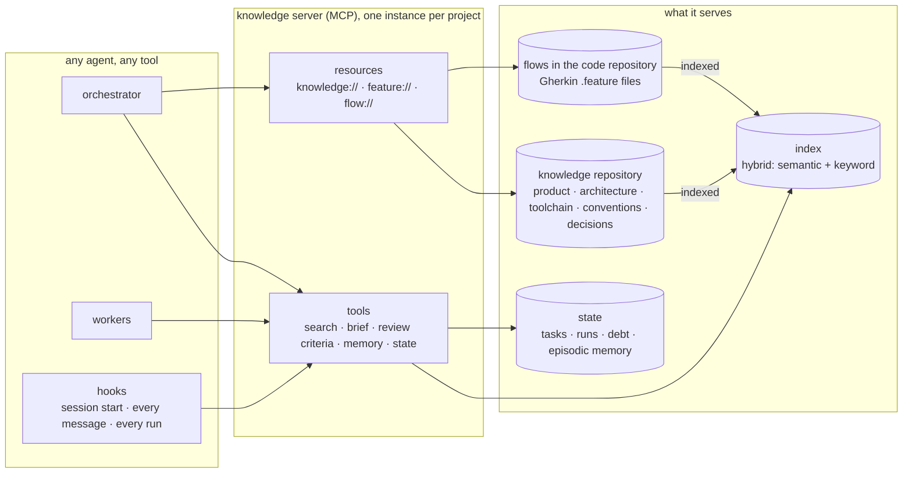
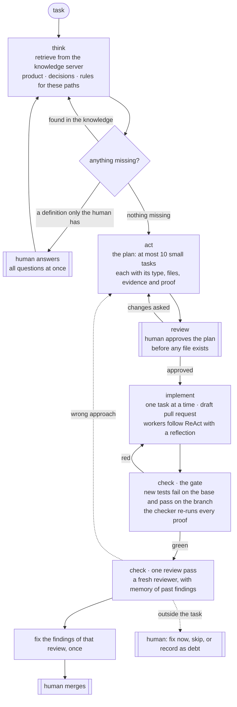

# TypedSpec

**The TypeScript of Spec-Driven Development.** TypeScript did not replace JavaScript; it added types a machine checks before the code runs. TypedSpec does not replace SDD; it keeps what SDD already does and makes it verifiable.

> **No receipts, no merge.**

[Leer en español](README.es.md)

---

## Why this exists

I spent months building a harness for developing a real product with AI coding agents: hooks, gates, skills, validators. At one point the project carried more than one line of harness for every line of product, and most of it only fit that one product.

Two lessons came out of it:

1. **The harness is not what matters most. Context is.** What changed the quality of the work was *what the agent sees, at which moment, and with which guarantees*. That is context engineering, and TypedSpec is a method for doing it on purpose.
2. **Most of what I hand-built already existed.** Executable specifications, living documentation, decision records, red-green testing: people worked these out over decades. A method for AI agents should stand on them, not reinvent them.

## Built on

TypedSpec invents little. It puts proven practices in front of AI agents and adds the two pieces they need:

| Practice | What TypedSpec takes from it |
|---|---|
| [Behaviour-Driven Development](https://dannorth.net/introducing-bdd/) (Dan North) and [Gherkin](https://cucumber.io/docs/gherkin/) | Flows written in the language of the business, executable |
| Specification by Example (Gojko Adzic) | The spec, the test and the documentation are one artifact |
| Living Documentation (Cyrille Martraire) | Documentation that cannot go stale, because it fails when it lies |
| TDD and ATDD | The acceptance test first; it must fail before the change exists |
| [Architecture Decision Records](https://cognitect.com/blog/2011/11/15/documenting-architecture-decisions) (Michael Nygard) | One short decision per file, never deleted, only superseded |
| Ubiquitous language (DDD, Eric Evans) | The same words in the flows, the code and the user interface |

What is new is the **knowledge server** that gives every agent exactly the context it needs, and the **checker** that re-runs every proof instead of believing the agent.

## The premise

**A harness can be built incrementally, while the code is being written, and it evolves with the people using it.** Every task tests it against the project's knowledge and, when something is missing, completes it:

- **A missing definition**: the orchestrator guides the human — *"to continue, you need to define A and B"* — all at once, and only what blocks.
- **A missing rule**: it proposes a harness change (a test, an eval, an end-to-end flow, a hook) and the human approves the diff.
- **Rules, not prose**: a rule the model can ignore is a wish. Every rule is an executable check.
- **Dynamic both ways**: every rule records when it fires; a rule that never fires is proposed for retirement.

## The same for every project

TypedSpec is a factory, not a harness for one product. The method is identical for a restaurant, a bank, a public institution, a law firm, a retailer or a video game, on any stack. A project only declares its own values, in its own knowledge.

| Always the same | Declared by each project |
|---|---|
| The graph: think → act → review → implement → check | What each node checks in that domain |
| Task types (feature, bug, chore, harness, question) and their fields | The layers and the files each one owns |
| Human stops: the plan and the merge | The risk areas that add a stop |
| Gates exist; the new test fails before the change and passes after; proofs are re-run by a checker | The commands (`pnpm verify`, `pytest`, `go test`) |
| TDD always; end-to-end when a user-visible flow exists | The evidence per layer (component story, API collection, replay test) |
| Flows in Gherkin, parsed by the official parser, in the project's language | The runner for the stack (playwright-bdd, behave, godog) |
| One knowledge layout, so every project serves the same resources | Its content: product, architecture, toolchain, regulation |
| Agents by role: implementer, reviewer, build fixer, debugger, explorer | The review criteria, injected as context |
| Skills by activity: plan, review, status, save a checkpoint | The data they read |

Before adding any piece, ask two questions: *would it work unchanged on another stack (a Python API, a Go service)?* and *would it work unchanged in another domain (a bank, a law firm, a video game)?* If not, the varying part belongs to the project's knowledge, not to the method.

## The foundation: a knowledge server

Everything reads from and writes to one place: a **knowledge server**, built as an [MCP](https://modelcontextprotocol.io) server. The harness can change shape; the knowledge server is what keeps every agent, in every tool, working from the same context. One instance serves one project, with its own store.



- **Three stores, never mixed.** *Knowledge* is curated text in a repository, versioned and reviewed. *Episodic memory* (what a run learned) is dated and expires unless it is promoted to a decision. *Operational state* (tasks, runs, debt) is typed rows, queried by filters, never embedded.
- **Two halves of retrieval.** A hybrid index answers *what is similar*, across languages; the relational store answers *what is exact*: which decision governs this module, which rule applies to this path.
- **Context arrives without asking.** Before the model reads a human's message, a hook asks the server for what is relevant and injects it. Greetings get nothing, so they cost nothing.
- **Review criteria by path.** A reviewer receives the rules that apply to the files in the diff and the exact text of the flows the task touches.
- **Flows as diagrams, generated.** `flow://<capability>` draws the Gherkin scenarios as a diagram on request, so the picture can never disagree with the spec.
- **Memory that outlives a session.** A new session starts from the last summary and the pending work, whichever agent opens it.
- **Telemetry in the same place.** Every run records its worker, node, model, tokens, duration and verdict.

## The graph

Every change walks the same graph. Two steps belong to a human: approving the plan and merging.



- **think** keeps searching the knowledge before it asks; it asks the human only what the knowledge cannot answer, and everything at once.
- **act** writes the plan. A task too big to fit is split; a task without an executable proof is not a task.
- **review** is the first human stop, before any code exists, when changing direction is cheapest.
- **implement** runs workers that follow ReAct with one reflection line. Their stated confidence is recorded as a metric, never taken as evidence. The fourth failure escalates with the hypotheses tried.
- **check** has two parts. The gate proves the change mechanically: every new test must fail on the base and pass on the branch, and the checker re-runs the proofs itself. Then one review pass; its findings are fixed once, and the human merges. No review loops.

## Evidence by task type

The method demands one thing of every task: an executable proof that fails without the change. Which proof is the project's choice, by type and layer.

| Type | The method demands | What one project chose (a web SaaS) |
|---|---|---|
| feature | the flow's scenario fails first, then passes | component: story + unit test · API: contract test, API collection with asserts, documented endpoint · flow: Gherkin end-to-end |
| bug | the reproduction fails on the base and passes on the branch | the same reproduction, as a test |
| chore | existing tests stay green, untouched | — |
| harness | a test of the script or hook, or an eval | eval for an agent or a prompt change |
| question | an answer within its limit; no code | — |

A video game would choose replay and simulation tests; a bank would add an audit-trail check for every money movement. The rule is the same: assert business values, never structure — *the total is 12980*, not *the total is greater than zero*, and never class names or markup.

## Specs that run

A flow is written once, in Gherkin, in the language of the business, and it is the specification, the test and the documentation at the same time:

```gherkin
# language: en
Feature: Order history
  Scenario: A diner sees only their own orders
    Given a restaurant "demo" with a product "Pizza" at 9990 and delivery at 2990
    When a guest orders 1 "Pizza" as "ana@test.com"
    And "ana@test.com" opens their order history
    Then they see 1 order with total 12980
    And they do not see orders from "luis@test.com"
```

- **The flows outlive the technology.** Steps find things the way a user does — by role and visible text — never by class names. Delete the source code, rebuild it on another framework, and the flows tell you when it is done.
- **The flows live next to the code** that makes them pass, so a flow and its steps change in one pull request. The knowledge server indexes and serves them.
- **Write them in business terms.** "When a guest orders 2 pizzas", not "click, type, click". Imperative scenarios are the classic way BDD rots.

More: [`examples/`](examples/).

## The knowledge layout

Every project's knowledge has the same shape, so the server offers the same resources everywhere:

```
knowledge/<project>/
  index.md        the map: one line per current document
  prd/            what is built and why: product, users, requirements, roadmap
  asd/            architecture: stack, boundaries, patterns, data
  dtr/            toolchain: versions, build, tests, CI, scripts
  conventions/    how work is done: code, review, process
  decisions/      ADRs, one numbering
  howto/          task guides, one task per file
  history/        frozen records: changes, audits, research, plans, snapshots
  assets/         images, PDFs, recordings: never indexed, linked from the text that explains them
```

Every document carries frontmatter (`id`, `type`, `status`, `summary`, `links`, `supersedes`), so the documents form a graph the server can follow, and search returns only what is current unless history is asked for. Research never edits the product or the flows directly: what is worth keeping becomes a decision or a scenario through a diff the human approves.

## Context engineering principles

1. **Retrieve before you prompt.** Agents get the rules for the files they will touch, not whole documents. This is also the answer to *lost in the middle*.
2. **Rules as code, not prose.** Instruction prose is not allowed to grow: a check counts its words.
3. **Confidence is a metric, not evidence.** "Done, it works" proves nothing; a separate process re-runs the proof.
4. **Plan before code.** Fixing a plan is far cheaper than fixing code.
5. **Measure before deciding.** One example: automatically summarising context that retrieval had already filtered lost up to half of the facts that mattered.
6. **Use the practice that exists.** Before writing a new script, name the established practice that solves it and use its standard tool.
7. **The harness grows and shrinks.** Rules that never fire leave.

## Status

The principles come from months of daily practice on a real product. The method is being piloted now, one short pull request at a time, starting with moving that product's hand-written smoke scripts to Gherkin flows. This repository will collect what the pilot measures, including what does not work.

## License

[CC BY 4.0](LICENSE): share and adapt with attribution.
