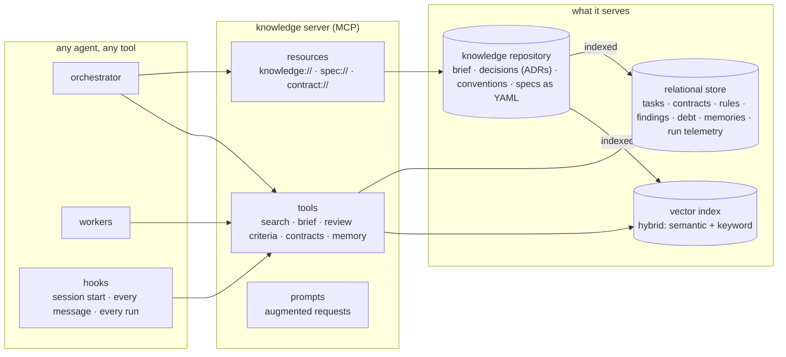
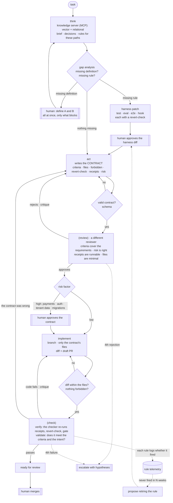

# TypedSpec

**The TypeScript of Spec-Driven Development.** TypeScript did not replace JavaScript; it added types a machine checks before the code runs. TypedSpec does not replace SDD; it keeps what SDD already does and makes it verifiable.

> **No receipts, no merge.**

[Leer en español](README.es.md)

---

## Why this exists

I spent months building a harness for developing a real product with AI coding agents: hooks, gates, skills, validators. At one point the project carried more than one line of harness for every line of product.

The lesson was not the one I expected. **The harness is not what matters most. Context is.** What changed the quality of the work was *what the agent sees, at which moment, and with which guarantees*. That is context engineering, and TypedSpec is a method for doing it on purpose.

## The premise

**A harness can be built incrementally, while the code is being written, and it evolves with the people using it.** You do not write it all up front. Every task tests it against the project's knowledge (brief, architecture decisions, past decisions) and, when something is missing, completes it:

- **A missing definition**: the orchestrator guides the human — *"to continue, you need to define A and B"* — all at once, and only what blocks.
- **A missing rule**: it proposes a harness patch (a test, an eval, an end-to-end check, a hook) and the human approves the diff.
- **Rules, not prose**: every new rule is an executable check, born with a revert-check proving it can fail. A rule that can never fail is prose in disguise.
- **Dynamic both ways**: every rule records when it fires. A rule that never fires is proposed for retirement, so the harness does not grow fat.

## The foundation: a knowledge server

Everything in TypedSpec reads from and writes to one place: a **knowledge server**, built as an [MCP](https://modelcontextprotocol.io) server. It is the center of the method, not an accessory. The harness can change shape; the knowledge server is what keeps every agent, in every tool, working from the same context.



What it does, and why each part matters:

- **Knowledge lives once, outside the code.** The project brief, architecture decisions, conventions and specs live in their own repository, versioned and reviewed. The server indexes them; nobody copies them into prompts by hand.
- **Two halves of retrieval.** A hybrid vector index (semantic plus keyword, multilingual, so a request in one language finds knowledge written in another) answers *what is similar*. A relational store answers *what is exact*: which decision governs this module, which rule applies to this path, which check enforces it, which task this run belongs to.
- **Context arrives without asking.** Before the model reads a human's message, a hook asks the server for what is relevant and injects it. Greetings and confirmations get nothing, so they cost nothing.
- **Briefs for workers.** Workers that cannot call the server themselves get a brief built from short, focused queries, deduplicated and filtered by a score floor, instead of whole documents.
- **Review criteria by path.** A reviewer receives the review rules that apply to the files in the diff, plus the exact text of the scenarios the task cites.
- **Contracts and tasks as validated records.** The server refuses a contract or a task record that breaks its schema, so an invalid one never gets stored.
- **Memory that outlives a session.** Decisions, discoveries and session summaries are stored and recalled by meaning. A new session starts from the last summary and the pending work, whichever agent or tool opens it.
- **Telemetry in the same place.** Every run records its worker, node, model, tokens, duration and verdict, so cost and quality are measured where the context lives.
- **Tools and resources.** Agents call tools when they need something; humans and orchestrators attach resources (`knowledge://…`, `spec://…`, `contract://…`) when they want an exact piece of context in view.
- **One instance per project.** The same server code serves several projects, each with its own knowledge and its own store.

This is why the harness is secondary. Hooks, gates and skills enforce rules, and they are only as good as the context they act on. The knowledge server is what makes that context exact, shared and measurable.

## What SDD already gives, and what TypedSpec adds

Birgitta Böckeler (Thoughtworks) describes three levels of SDD: *spec-first*, *spec-anchored* and *spec-as-source*. TypedSpec sits at **spec-as-source** and keeps SDD's core:

| SDD already does | TypedSpec keeps it and adds |
|---|---|
| Requirements and scenarios (GIVEN / WHEN / THEN) | Scenarios as **structured records** (YAML) with stable IDs, linked to the tests that enforce them |
| A plan approved before implementing | A **typed contract** per pull request, validated by a schema and reviewed *before* any code |
| Tasks with acceptance criteria | Acceptance criteria plus allowed files, forbidden actions, a revert-check and a **risk factor** |
| Review and CI | **Receipts**: the proof commands are re-run by a separate checker, never taken from the agent's word |

| TypeScript | TypedSpec |
|---|---|
| types | the contract: acceptance criteria, files, forbidden, receipts, risk |
| `tsc` before running | the schema and the contract review before implementing |
| tests at runtime | the check: receipts re-run by the checker |
| `strict` | high risk: a human approves the contract |

## The graph

Every pull request walks the same directed graph. **Nodes in parentheses repeat until they pass**, bounded: the fourth failure escalates to a human with the hypotheses tried.



In the vocabulary of agent patterns, this is a **workflow** (paths fixed in code, not chosen by the model): prompt chaining with programmatic gates, two **evaluator-optimizer** loops (contract review and implementation check), **routing** by risk, a human **interrupt** only on high risk, and **orchestrator-workers** (one orchestrator, cheaper workers). Each worker follows ReAct with a reflection line, and its stated confidence is a metric, never evidence.

### Nodes and gates

| Node | Leaves behind | The outgoing edge checks it with | Repeats |
|---|---|---|---|
| think | a brief: similar knowledge (vector) and what governs these paths (relational) | fixed edge | no |
| gap analysis | missing definitions and missing rules | three exits: guide the human, patch the harness, go on | back to think after each definition |
| harness patch | a new test, eval, e2e or hook, with its revert-check | the revert-check fails without the rule; a human approves the diff | no |
| act | the **contract**, stored as a schema-validated record | the schema: an invalid contract is not stored | when review rejects |
| (review) | verdict and critique | a fixed path rule for risk (cannot be lowered by hand) plus the reviewer's judgment | up to 3, the 4th escalates |
| implement | a diff on a branch and a draft PR | the diff stays within the contract's files; nothing forbidden is touched | when check fails |
| (check) | receipts re-run by the checker, gate result, review | **verify**: receipts come from the checker, never from the implementer · **validate**: criteria against the diff | up to 3, the 4th escalates |

## Context engineering principles

1. **Retrieve before you prompt.** Agents do not get whole documents. They get the rules that apply to the files they will touch, from a knowledge base with two halves: vector search for *what is similar*, relational data for *what is exact* (which decision governs this module, which rule applies to this path, which check enforces it). This is also the answer to *lost in the middle*.
2. **Rules as code, not prose.** A rule the model can ignore is a wish. Every rule is a test, a hook or an eval. Instruction prose is not allowed to grow: a check counts its words.
3. **Confidence is a metric, not evidence.** "Done, it works" proves nothing. A separate process re-runs the proof. This is how fabricated evidence gets caught.
4. **Contract before code.** Fixing a contract is far cheaper than fixing code.
5. **Risk decides when the human steps in.** High-risk changes stop for a human at the contract; low-risk changes only stop at the merge.
6. **Measure before deciding.** Ideas that sound good get measured first. One example from practice: automatically summarising context that retrieval had already filtered lost up to half of the facts that mattered.
7. **The harness grows and shrinks.** Rules that never fire leave.

## Spec as source

A scenario is a record, not a paragraph. The YAML in the repository is the source of truth (reviewed in pull requests, with git history); a database indexes it for fast, cheap queries by agents.

```yaml
- id: no-session-is-refused
  capability: orders
  given: an order without a session
  when: POST /orders
  then: responds 401
  applies_to: [apps/api/src/modules/orders/]
  decisions: [ADR-012]
  enforced_by: [orders.e2e-spec.ts#no-session-is-refused]
```

- **Drift becomes a red check:** a scenario whose `enforced_by` does not exist, or a test citing an unknown ID, fails the gate.
- **Exact context:** each agent receives only the scenarios whose `applies_to` matches the files in its contract.

More examples: [`examples/scenario.yaml`](examples/scenario.yaml), [`examples/contract.yaml`](examples/contract.yaml).

## The building blocks

TypedSpec is model-agnostic and tool-agnostic. Around the knowledge server described above, it runs on:

- **hooks** that turn rules into hard stops (no push to the main branch, no merge without green checks, every PR starts as a draft);
- a **local gate** that runs the same steps as CI on an empty database and publishes its verdict;
- **telemetry per run**: which worker ran which node, tokens, duration, retries, and which rule fired.

## Status

The principles above come from months of daily practice on a real product. The full graph is being piloted now, one short pull request at a time; this repository will collect what the pilot measures, including what does not work.

## License

[CC BY 4.0](LICENSE): share and adapt with attribution.
